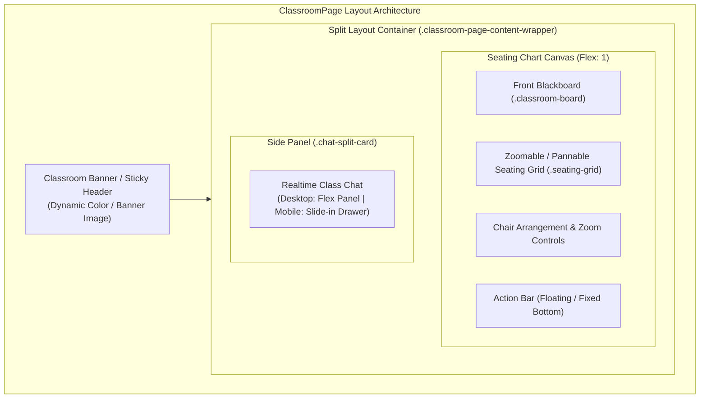

# 🎨 ClassroomPage Design System & Design Tokens Specification

> **Project:** Echair — Modern Classroom Management System  
> **Source Files Analyzed:** `ClassroomPage.jsx`, `ClassroomPage.css`, `ClassroomPage-main-wrapper.css`, `Main.css`, `html.css`  
> **Target Audience:** Frontend Engineers, UI/UX Designers, Maintainers  
> **Last Updated:** พฤศจิกายน 2026  

---

## 📌 1. ภาพรวมสถาปัตยกรรมหน้าจอ (Architectural Overview)

หน้า **ClassroomPage** เป็นหน้าจอหลักที่ซับซ้อนที่สุดของระบบ Echair โดยรวมการจัดการผังห้องเรียนแบบเรียลไทม์ (Interactive Seating Chart), การแชตแบบแยกส่วน (Split-View Realtime Chat), กระดานหน้าชั้น (Blackboard), เมนูควบคุมและจัดผังที่นั่ง (Chair Arrangement & Zoom Controls) และแถบสั่งการ (Action Bar)



---

## 🎨 2. Color Tokens (ระบบสีและการแสดงผล)

### 2.1 Brand & Primary Green Palette (สีเขียวหลักของระบบ Echair)
ระบบใช้เฉดสีเขียวธรรมชาติ (Echair Eco-Green) สะท้อนถึงบรรยากาศการเรียนรู้ที่สบายตา

| Token Name | Hex Code | ตัวอย่าง | บทบาทและการใช้งาน |
|---|---|:---:|---|
| `--color-green-primary` | `#7ec282` | `rgb(126, 194, 130)` | สีแบรนด์หลัก, ขอบไฮไลต์, ปุ่มบันทึก, ไอคอนหลัก |
| `--color-green-hover` | `#6bb36f` | `rgb(107, 179, 111)` | สถานะ Hover ของปุ่มหลัก |
| `--color-green-active` | `#5a9f5e` | `rgb(90, 159, 94)` | สถานะ Active / Clicked |
| `--color-green-success` | `#28a745` | `rgb(40, 167, 69)` | สถานะความสำเร็จ, ไอคอนเช็กถูก, ที่นั่งเช็กชื่อแล้ว |
| `--color-green-tint` | `#f0fff4` | `rgb(240, 255, 244)` | สีพื้นหลังกล่องแจ้งเตือนความสำเร็จ, ไฮไลต์แถวที่เลือก |
| `--color-green-bg-soft` | `#e8f5e8` | `rgb(232, 245, 232)` | พื้นหลัง Badge หรือแท็กที่มีสถานะปกติ |

### 2.2 Neutral Palette (โครงสร้างพื้นหลัง, การ์ด และข้อความ)
ใช้โทน Slate/Cool Neutral เพื่อความสะอาด คมชัด และตัดกับสีเขียวของเก้าอี้ได้อย่างชัดเจน

| Token Name | Hex Code | บทบาทและการใช้งาน |
|---|---|---|
| `--color-bg-page` | `#f0f2f5` / `#e8f2e9` | พื้นหลังใหญ่ของหน้า Classroom และ Main Wrapper |
| `--color-surface-card` | `#ffffff` | พื้นหลัง Inner Card ของผังห้องเรียน และ Side Drawer |
| `--color-surface-canvas` | `#f8fafc` | พื้นหลังผังเก้าอี้ (Seating Canvas) เพื่อให้แยกออกจาก Card |
| `--color-surface-muted` | `#f1f5f9` / `#eef0f2` | พื้นหลังปุ่มรอง, แถบเครื่องมือย่อ/ขยาย, Tab Header |
| `--color-border-subtle` | `#e2e8f0` | เส้นแบ่งการ์ด, เส้นขอบแชต, เส้นขอบแถบควบคุม |
| `--color-border-medium` | `#cbd5e1` / `#ddd` | เส้นขอบ Input, เส้นแบ่งตาราง |
| `--color-text-primary` | `#212529` / `#333333` | หัวข้อหลัก, ชื่อห้องเรียน, ชื่อเก้าอี้ที่เลือก |
| `--color-text-secondary`| `#475569` / `#555555` | คำอธิบาย, ข้อมูลรหัสชั้นเรียน, สถิตินักศึกษา |
| `--color-text-muted` | `#64748b` / `#888888` | ข้อความรอง, ไอคอนที่ยังไม่ Active, วันที่ |
| `--color-text-subtle` | `#94a3b8` / `#bbb` | Placeholder, ตัวเลขย่อย, สถานะว่าง |

### 2.3 Semantic & Activity Status Palette (สีสถานะและกิจกรรม)
ใช้สำหรับระบุสถานะเก้าอี้ การเช็กชื่อ (Attendance) และคะแนนกิจกรรม

| สถานะ (Status) | Hex Code | การใช้งานใน ClassroomPage |
|---|---|---|
| **Present / Normal (มาเรียน)** | `#28a745` | เก้าอี้ที่มีนักศึกษานั่งและเช็กชื่อแล้ว |
| **Late (มาสาย)** | `#ffc107` / `#e0a800` | สีเตือนสถานะมาสาย (Warning) |
| **Absent (ขาดเรียน)** | `#dc3545` / `#c82333` | เก้าอี้ที่ระบุว่าขาดเรียน (Danger) |
| **Leave (ลา)** | `#17a2b8` / `#337ab7` | สถานะการลาเรียนที่มีใบรับรอง |
| **Unassigned (เก้าอี้ว่าง)** | `#cbd5e1` / `#d1d1d1` | ขอบและไอคอนเก้าอี้ที่ไม่มีผู้ครอบครอง |
| **Group / Team Accent** | `#6f42c1` | ไฮไลต์การสุ่มกลุ่ม (Grouping Modal) |

### 2.4 Blackboard Specialized Palette (กระดานหน้าชั้น)
| Token Name | Hex Code | การใช้งาน |
|---|---|---|
| `--color-blackboard-bg` | `#2e4d34` / `#1e293b` | สีเขียวกระดานดำเข้มคลาสสิก หรือ Slate ดำลึก |
| `--color-blackboard-border`| `#8d6e63` / `#475569` | สีกรอบไม้ของกระดาน หรือกรอบอลูมิเนียมโมเดิร์น |
| `--color-blackboard-chalk` | `#ffffff` (opacity: 0.9) | ตัวอักษรสีชอล์กขาว "กระดานหน้าชั้นเรียน / Front" |

---

## 🔤 3. Typography System (ระบบตัวอักษร)

### 3.1 Font Family Stack
```css
/* Standard Font Family */
font-family: "Noto Sans Thai", -apple-system, BlinkMacSystemFont, "Segoe UI", Roboto, Helvetica, Arial, sans-serif;
```
- **Primary Typeface:** `Noto Sans Thai` (อ่านง่าย สระภาษาไทยไม่จมและไม่ลอย)
- **Fallback Typeface:** ระบบ Native OS Font Stack สำหรับภาษาอังกฤษและตัวเลขอารบิก

### 3.2 Typography Scale & Hierarchy

| บทบาท (Role) | ขนาด (Size) | Weight | Line Height | การใช้งานในหน้า Classroom |
|---|---|---|---|---|
| **Page Title (Banner)** | `2.00rem` (32px) | `700` | 1.25 | ชื่อห้องเรียนบน Banner (ลดเป็น `1.6rem` บนมือถือ) |
| **Section Title** | `1.50rem` (24px) | `700` | 1.30 | "ผังที่นั่งห้องเรียน", "รายชื่อนักศึกษา" |
| **Modal / Card Title** | `1.25rem` (20px) | `600` | 1.35 | หัวข้อ Modal สุ่มเก้าอี้, หัวข้อ Modal แชต |
| **Subheading / Medium** | `1.10rem` (18px) | `600` | 1.40 | รหัสชั้นเรียน (Class Code), ชื่อหมวดหมู่ |
| **Body Standard** | `0.95rem` (15px) | `400` / `500` | 1.50 | ข้อความทั่วไป, รายการเมนู Dropdown |
| **Body Small** | `0.85rem` (14px) | `400` | 1.45 | ข้อความแชต, คำอธิบายเครื่องมือ Tooltip |
| **Chair Label (Full)** | `0.70rem` (11px) | `600` | 1.20 | ชื่อนักศึกษาบนเก้าอี้ (Zoom ปกติ) |
| **Chair Label (Micro)**| `0.55rem` (9px) | `600` | 1.10 | หมายเลขที่นั่ง / รหัสเก้าอี้ตอน Zoom ออก |

---

## 📐 4. Spacing, Radius & Elevation Tokens

### 4.1 Spacing Scale (ระยะห่างและ Padding)
```css
--space-xs: 4px;    /* Icon gaps, badge padding */
--space-sm: 8px;    /* Button inner padding, canvas margin */
--space-md: 12px;   /* Card inner gaps, input paddings */
--space-lg: 16px;   /* Seating container padding, toolbar gap */
--space-xl: 20px;   /* Section margins, banner padding */
--space-2xl: 24px;  /* Modal padding */
```

### 4.2 Border Radius Scale
```css
--radius-xs: 2px;   /* Micro badges */
--radius-sm: 4px;   /* Tag, chair corners (compact) */
--radius-md: 8px;   /* Standard buttons, dropdowns, inputs */
--radius-lg: 12px;  /* Seating canvas container, modals */
--radius-xl: 16px;  /* Main classroom card, banner */
--radius-pill: 50px;/* Badge, action pill buttons */
--radius-circle: 50%; /* User avatars, circular action icons */
```

### 4.3 Box Shadows (มิติและระดับชั้น Elevation)
```css
/* ระดับที่ 1: การ์ดและผังที่นั่งปกติ (Subtle Card) */
--shadow-sm: 0 1px 3px rgba(0, 0, 0, 0.08);

/* ระดับที่ 2: Card Hover & Dropdown (Interactive Elevation) */
--shadow-md: 0 4px 6px rgba(0, 0, 0, 0.05), 0 2px 4px rgba(0, 0, 0, 0.05);

/* ระดับที่ 3: Chat Side Drawer & Action Bar (Floating UI) */
--shadow-lg: 0 4px 16px rgba(25, 118, 210, 0.08), 0 2px 8px rgba(0, 0, 0, 0.08);

/* ระดับที่ 4: Floating Modals & Mobile Overlays */
--shadow-xl: 0 8px 24px rgba(0, 0, 0, 0.15), -2px 0 10px rgba(0, 0, 0, 0.1);
```

---

## 🧩 5. Core Component Patterns (โครงสร้างคอมโพเนนต์หลัก)

### 5.1 Banner & Collapsible Header
- **Dynamic Background:** ดึงค่าสีจาก `classroom.color` หรือภาพ `classroom.bannerUrl`
- **Contrast Protection:** มี Overlay สีขาวหรือมืด (`rgba(0, 0, 0, 0.35)`) ช่วยให้ตัวหนังสืออ่านชัดเจน 100%
- **Collapsible Behavior:** มีปุ่มพับเก็บ Banner (`.banner-collapse-btn`) เพื่อเพิ่มพื้นที่การมองเห็นผังเก้าอี้บนจอขนาดเล็ก

### 5.2 Seating Grid & Canvas (ผังเก้าอี้)
- **Interactive States:**
  - `cursor: grab` ตอนเปิดโหมด Pan ผังห้อง
  - `cursor: grabbing` ตอนกำลังลากผังห้อง
- **Centering Engine:** ใช้ Flexbox + `margin: auto` ป้องกันการหลุดขอบ (Anti-clipping centering)
- **Front Indicator:** `.classroom-board` วางอยู่ตำแหน่งบนสุดเสมอ เพื่อเป็นจุดอ้างอิงหน้าห้อง

### 5.3 Split-View Chat Panel
- **Desktop (>= 1025px):** ยึดพื้นที่ด้านขวาในอัตราส่วน Flex คงที่ มี Toggle เปิด/ปิด ได้อย่างนุ่มนวล
- **Mobile (<= 768px):** แปลงเป็น Drawer สไลด์คลุมทั้งหน้าจอ (`fixed` overlay `z-index: 1000`)

---

## 📱 6. Responsive Breakpoint Rules

| Breakpoint | Target Screen | พฤติกรรม Layout |
|---|---|---|
| **Mobile (`<= 768px`)** | Smart Phone | Banner ซ่อน Subtitle อัตโนมัติ, ปุ่ม Action ปรับเป็นทรงกลมแสดงเฉพาะไอคอน, Chat แปลงเป็น Full-screen Drawer |
| **Tablet (`769px - 1024px`)** | iPad / Tablets | Seating Canvas ปรับขนาดเก้าอี้เล็กลง 15%, Split View ย่อแถบ Chat เหลือความกว้าง 280px |
| **Desktop (`>= 1025px`)** | Laptops / PC | แสดงผลผังห้องเรียนเต็มตาคู่กับแถบแชต 340px - 380px, Action Bar ลอยตัวด้านล่าง |

---

## 💡 7. คำแนะนำสำหรับการ Refactor ให้เป็น CSS Variables (Clean Code Recommendation)

หากต้องการให้โค้ดสะอาดและดูแลรักษาง่ายตามมาตรฐาน ให้สร้างไฟล์ `tokens.css` และแทนที่ค่าสี Hex ใน `ClassroomPage.css` ด้วย Semantic Tokens ด้านล่างนี้:

```css
:root {
  /* Brand */
  --echair-primary: #7ec282;
  --echair-primary-hover: #6bb36f;
  --echair-primary-active: #5a9f5e;
  
  /* Canvas & Card */
  --echair-bg: #f0f2f5;
  --echair-surface: #ffffff;
  --echair-canvas: #f8fafc;
  --echair-border: #e2e8f0;
  
  /* Typography */
  --echair-font: "Noto Sans Thai", sans-serif;
  --echair-text-main: #212529;
  --echair-text-muted: #64748b;
  
  /* Status */
  --echair-present: #28a745;
  --echair-late: #ffc107;
  --echair-absent: #dc3545;
}
```
